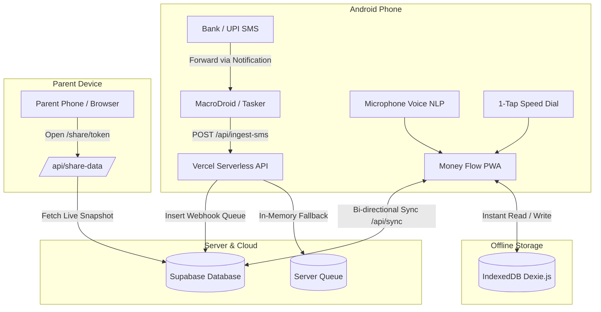

# 💸 Money Flow — Personal Finance & Expense Tracker PWA

[](https://nextjs.org/)
[](https://www.typescriptlang.org/)
[](https://tailwindcss.com/)
[](https://dexie.org/)
[](https://supabase.com/)
[](https://web.dev/progressive-web-apps/)

**Money Flow** is an offline-first Progressive Web App (PWA) designed for modern daily personal expense tracking, automated Indian bank & UPI SMS ingestion, smart statement reconciliation, and transparent financial sharing.

---

## 🌟 Key Features

### 1. Daily "Safe-to-Spend" Barometer
- Calculates dynamic daily spending runway:
  $$\text{Daily Limit} = \frac{\text{Monthly Budget} - \text{Fixed Recurring Bills} - \text{Total Spent so far}}{\text{Days Remaining in Month}}$$
- Subtracts upcoming rent and recurring bills automatically so your daily safe limit never falsely inflates before fixed bills hit.

### 2. 1-Tap Frequent Spends Speed Dial
- Instant logging for daily micro-spends: `Chai ₹15`, `Vadapav ₹20`, `Bus Ticket ₹25`, `Auto ₹40`, `Cold Coffee ₹50`, `Milk ₹33`.
- Haptic feedback vibration (`navigator.vibrate(50)`) with a 3-second quick **Undo** toast.

### 3. Split & IOU Ledger (Mini-Splitwise)
- Split any expense equally or by custom amounts.
- **Accounting Rule:** Only *your personal share* counts toward your spending and budget totals. Friends' unpaid portions are tracked under **"Pending IOUs (Owed to Me)"** so group dinners or shared cabs never distort your true analytics.
- **1-Tap WhatsApp Reminder:** Opens pre-filled polite reminder messages with amount and date (`wa.me`).
- **Auto-Settlement Hook:** When an incoming credit SMS arrives matching a friend's pending IOU, 1 tap marks it settled.

### 4. Recurring Bills & Subscriptions Manager
- Tracks Netflix, Spotify, Wi-Fi, Gym, Rent, and Mobile recharges.
- Active monthly bills auto-feed directly into the Safe-to-Spend formula.
- 7-day upcoming bill alert banners with 1-tap **"Mark Paid"** that advances the next due date by 1 month.

### 5. Hands-Free Voice Input (Indian English NLP)
- Native Web Speech Recognition (`en-IN`) understands Indian accents, Rupee amounts, and local spots (*"Spent 140 on Zomato"*, *"Paid 35 for Vadapav"*, *"Split 600 dinner with Rahul"*).
- 2-second auto-save countdown for hands-free convenience.

### 6. Read-Only Parent Guardian View (`/share/[token]`)
- Unique, revocable tokenized links for parents/guardians.
- Displays income, personal expenses, savings rate, and category breakdowns.
- Excludes pending IOUs from spending totals and allows hiding personal notes with a privacy toggle.

### 7. PIN Security & Inactivity Lock
- 4-digit fintech numpad with salted SHA-256 hash stored locally.
- Configurable auto-lock after 5 minutes of idle time.

### 8. Automated Bank / UPI SMS Capture
- Webhook endpoint `/api/ingest-sms` with `X-API-Key` security.
- Custom regex engine for Indian SMS formats: **Bank of Maharashtra, SBI, HDFC, ICICI, Axis, GPay, PhonePe, Paytm, Swiggy, Zomato, PMPML**.
- Prompts with Web Push Notifications and instant categorization bottom sheets.

---

## 🏗️ Architecture



---

## 🚀 Quickstart (Local Development)

### 1. Clone & Install Dependencies
```bash
cd "money flow"
npm install
```

### 2. Configure Environment
```bash
cp .env.example .env.local
```
*(You can leave default values during local testing; IndexedDB provides full functionality out of the box).*

### 3. Run Development Server
```bash
npm run dev
```
Open [http://localhost:3000](http://localhost:3000) on your browser.

---

## ☁️ 2-Minute Supabase Setup (For Cloud Sync & Parent Links)

To enable live cross-device sync and parent share links across phones:

1. Create a free project at [supabase.com](https://supabase.com).
2. Go to **SQL Editor** -> Click **New Query**.
3. Open `supabase-schema.sql` from this repository, copy the entire script, and click **Run**.
4. Go to **Project Settings** -> **API**:
   - Copy **Project URL** -> `NEXT_PUBLIC_SUPABASE_URL`
   - Copy **anon public** key -> `NEXT_PUBLIC_SUPABASE_ANON_KEY`
   - Copy **service_role secret** key -> `SUPABASE_SERVICE_ROLE_KEY`
5. Paste these into your `.env.local` or Vercel Environment Variables.

---

## 🚢 Deploying to Vercel

1. Push your repository to GitHub:
   ```bash
   git init
   git add .
   git commit -m "feat: Money Flow PWA production release"
   git branch -M main
   git remote add origin https://github.com/your-username/money-flow.git
   git push -u origin main
   ```
2. Go to [vercel.com](https://vercel.com) and click **"Add New Project"**.
3. Import your `money-flow` repository.
4. In **Environment Variables**, add:
   - `NEXT_PUBLIC_SUPABASE_URL`: *(Your Supabase URL)*
   - `NEXT_PUBLIC_SUPABASE_ANON_KEY`: *(Your Supabase Anon Key)*
   - `SUPABASE_SERVICE_ROLE_KEY`: *(Your Supabase Service Role Key)*
   - `MONEY_FLOW_API_KEY`: *(Your secure webhook key)*
5. Click **Deploy**. Your app will be live on `https://your-app.vercel.app`!

---

## 📱 Android MacroDroid Setup (Automated SMS Capture)

Automate transaction capture the moment your bank sends an SMS or GPay/PhonePe pushes a notification:

1. Install **MacroDroid** from Google Play Store.
2. Tap **Add Macro** and configure:
   - **Trigger:**
     - `Notification` -> `Notification Received` -> Select **Messages / GPay / PhonePe / Paytm**.
   - **Actions:**
     - `Connectivity` -> `HTTP Request`:
       - **Request Method:** `POST`
       - **URL:** `https://your-app.vercel.app/api/ingest-sms`
       - **Content Type:** `application/json`
       - **Headers:** `X-API-Key: <your-webhook-secret-key>`
       - **Request Body:**
         ```json
         {
           "text": "[not_title] [not_body]"
         }
         ```
3. Save the Macro.
4. **Test inside Money Flow:**
   - Open Money Flow -> **Settings** -> **MacroDroid & Webhook** -> Tap **Setup Guide & Test** -> Click **Test Webhook Simulation**.
   - You will instantly receive a notification and prompt to categorize ₹140 spent at Zomato!

---

## 📲 Installing as a PWA on Your Phone

### Android (Chrome)
1. Open your Vercel deployment URL in Chrome.
2. Tap the `⋮` menu or wait for the bottom banner.
3. Tap **"Install App"** (or **"Add to Home Screen"**).
4. Money Flow runs as a standalone app with full offline support and Web Share target.

### iOS (Safari)
1. Open your Vercel deployment URL in Safari.
2. Tap the **Share** button (`⎙`).
3. Tap **"Add to Home Screen"**.

---

## 🛡️ Security & Privacy

- **On-Device Encrypted Storage:** All financial records are stored locally in IndexedDB (`Dexie.js`).
- **PIN Protection:** App is secured by salted SHA-256 hash with numpad lockout.
- **Privacy Mode in Parent View:** Toggle **"Hide Transaction Notes"** in Settings to display clean category figures to parents without sharing private merchant notes.
- **Full JSON & CSV Export:** Head to **Settings -> Backup & Vault** anytime to download a full `.json` snapshot or `.csv` spreadsheet.

---

## 📜 License
MIT License. Built with ❤️ for financial freedom.
